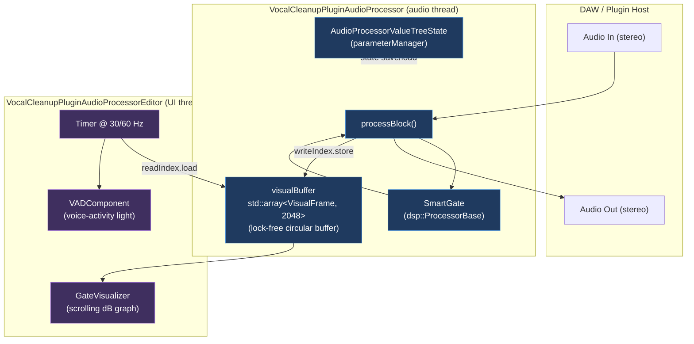
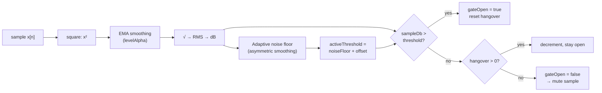

# Vocal Cleanup Plugin — Architecture Overview

A JUCE-based audio plugin (VST3/AU/AAX/Standalone) that removes low-level noise
between vocal phrases using an **adaptive noise gate**. The gate tracks the
ambient noise floor in real time and only opens when the signal rises a set
number of dB above that floor, so it adapts to different rooms and mics without
manual threshold tuning.

---

## High-Level Block Diagram

---

## Components

### 1. `VocalCleanupPluginAudioProcessor` — [PluginProcessor.h](PluginProcessor.h) / [PluginProcessor.cpp](PluginProcessor.cpp)
The core `juce::AudioProcessor`. Responsibilities:

- **`prepareToPlay()`** — builds a `juce::dsp::ProcessSpec` (sample rate, block
  size, channel count) and forwards it to the `SmartGate` module.
- **`processBlock()`** — the real-time audio callback. Wraps the buffer in a
  `dsp::AudioBlock` / `ProcessContextReplacing`, runs it through `gate.process()`,
  then snapshots the gate's state into the `visualBuffer` circular buffer.
- **`visualBuffer`** — a lock-free `std::array<VisualFrame, 2048>` written by the
  audio thread (`writeIndex`) and read by the UI thread (`readIndex`). Each
  `VisualFrame` stores `signalDb`, `noiseFloorDb`, `activeThresholdDb`, and
  `isGateOpen`.
- **`parameterManager`** — an `AudioProcessorValueTreeState` for state
  persistence (`getStateInformation` / `setStateInformation`). Its parameter
  layout is currently empty (no exposed parameters yet).

> Note: several fields (`currentGain`, `isVoiceDetected`, noise-floor tuning
> constants) are declared on the processor but the live gate logic now lives
> inside `SmartGate`. These are candidates for cleanup.

### 2. `SmartGate` — [SmartGate.h](SmartGate.h) / [SmartGate.cpp](SmartGate.cpp)
A self-contained DSP module (`juce::dsp::ProcessorBase`) implementing the
adaptive gate. This is the heart of the plugin.

**Per-sample signal chain inside `process()`:**

Key concepts:

- **RMS level detection** — an exponential moving average of squared samples
  (`smoothedSquares`) gives a ~10 ms RMS window (`levelTimeSec`).
- **Asymmetric noise-floor tracking** — the floor drops fast (`dropTimeSec ≈
  50 ms`) to find quiet quickly, but climbs slowly (`climbTimeSec ≈ 3 s`) so
  sustained speech doesn't drag the floor up and choke the gate.
- **Adaptive threshold** — `activeThresholdDb = noiseFloor + thresholdOffsetDb`
  (default offset 12 dB, exposable as a "sensitivity" control).
- **Hangover** — once open, the gate stays open for `hangoverTimeMs` (~100 ms)
  after the signal drops below threshold, preventing rapid chatter between words.
- All coefficients are recomputed from time constants in `prepare()` so behaviour
  is sample-rate independent.

#### Equations

**1. Level-smoothing coefficient** (computed once in `prepare()`):

$$\alpha = 1 - e^{-1 / (\tau_{level}\, f_s)}$$

**2. RMS via exponential moving average** (EMA of squared samples, per sample $n$):

$$s[n] = s[n-1] + \alpha\left(x[n]^2 - s[n-1]\right) = (1-\alpha)\,s[n-1] + \alpha\, x[n]^2$$

$$\text{RMS}[n] = \sqrt{s[n]}, \qquad L[n] = 20\,\log_{10}\!\big(\text{RMS}[n]\big)$$

**3. Noise-floor smoothing coefficients** (asymmetric, computed once in `prepare()`):

$$\beta_{drop} = e^{-1 / (\tau_{drop}\, f_s)}, \qquad \beta_{climb} = e^{-1 / (\tau_{climb}\, f_s)}$$

**4. Adaptive noise-floor update** (per sample; picks the coefficient by direction):

$$N[n] = L[n] + \beta\,\big(N[n-1] - L[n]\big) = \beta\,N[n-1] + (1-\beta)\,L[n], \quad
\beta = \begin{cases} \beta_{drop} & L[n] < N[n-1] \ \text{(falling → track fast)}\\[2pt] \beta_{climb} & L[n] \geq N[n-1] \ \text{(rising → track slow)} \end{cases}$$

**5. Active threshold and gate decision:**

$$T[n] = N[n] + \Delta, \qquad \text{gate open when } L[n] > T[n]$$

#### Symbol → implementation mapping

| Symbol | Meaning | Code variable | Set / computed in |
|--------|---------|---------------|-------------------|
| $x[n]$ | input sample | `newSample` (`block.getSample(0, i)`) | `process()` |
| $f_s$ | sample rate (Hz) | `sampleRate` | `prepare()` (from `spec.sampleRate`) |
| $\tau_{level}$ | RMS averaging time (~10 ms) | `levelTimeSec` | member init |
| $\alpha$ | EMA smoothing factor | `levelAlpha` | `prepare()` |
| $s[n]$ | smoothed mean-square | `smoothedSquares` | `process()` |
| $L[n]$ | instantaneous level (dB) | `sampleDb` | `process()` |
| $\tau_{drop}$ | floor fall time (~50 ms) | `dropTimeSec` | member init |
| $\tau_{climb}$ | floor rise time (~3 s) | `climbTimeSec` | member init |
| $\beta_{drop}$ | fall coefficient | `dropCoef` | `prepare()` |
| $\beta_{climb}$ | rise coefficient | `climbCoef` | `prepare()` |
| $N[n]$ | tracked noise floor (dB) | `currentNoiseFloorDb` | `process()` |
| $\Delta$ | threshold offset / sensitivity (12 dB) | `thresholdOffsetDb` | member / `setThresholdOffset()` |
| $T[n]$ | active gate threshold (dB) | `activeThresholdDb` | `process()` |

> Note on convention: in the code, `dropCoef` / `climbCoef` are the **retention**
> weights $\beta$ applied to the *previous* floor value $N[n-1]$. A larger $\beta$
> (from a longer time constant) keeps more of the old value, i.e. slower tracking —
> which is why $\beta_{climb} > \beta_{drop}$ makes the floor climb slowly but drop
> quickly. The same reasoning applies inversely to $\alpha$, where a larger value
> means faster response.

Accessors (`getSignalDb`, `getNoiseFloorDb`, `getActiveThresholdDb`, `isOpen`)
expose the gate's internal state to the UI for visualization.

### 3. `GateVisualizer` — [GateVisualizer.h](GateVisualizer.h) / [GateVisualizer.cpp](GateVisualizer.cpp)
A `juce::Component` + `Timer` that renders a scrolling dB history graph:

- On each 60 Hz timer tick it drains new frames from the processor's
  `visualBuffer` (comparing `readIndex` to the atomic `writeIndex`) into a local
  `displayHistory` vector.
- `paint()` maps each frame's dB values to screen coordinates and draws three
  lines — **white** signal, **red** active threshold, **grey** noise floor — plus
  a faint **green** vertical highlight wherever the gate was open.

### 4. `VocalCleanupPluginAudioProcessorEditor` — [PluginEditor.h](PluginEditor.h) / [PluginEditor.cpp](PluginEditor.cpp)
The plugin's UI (400×300). Hosts:

- **`VADComponent`** — a simple green/red box driven at 30 Hz from the
  processor's `isVoiceDetected` atomic (voice-activity indicator).
- **`GateVisualizer`** — the main scrolling graph.

The editor also implements `Slider::Listener` and `APVTS::Listener` interfaces,
though no interactive controls are wired up yet.

---

## Threading Model

| Thread | Runs | Shared state |
|--------|------|--------------|
| **Audio thread** | `processBlock()` → `SmartGate::process()` → writes `visualBuffer` | `writeIndex` (atomic), `isVoiceDetected` (atomic) |
| **UI thread** | `GateVisualizer` / editor timers → reads `visualBuffer` | `readIndex`, `writeIndex.load()` |

Communication is one-way and lock-free: the audio thread only ever writes and
advances `writeIndex`; the UI thread only reads. No allocations, locks, or UI
calls happen on the audio thread (per JUCE real-time rules).

---

## Data Flow Summary

1. Host delivers an audio block to `processBlock()`.
2. `SmartGate` processes it sample-by-sample: tracks the noise floor, computes an
   adaptive threshold, and mutes (zeroes) samples while the gate is closed.
3. The processor snapshots the gate's state into the lock-free `visualBuffer`.
4. UI timers pull those frames and render the scrolling graph + VAD light.
5. Cleaned audio is returned to the host.

---

## Potential Next Steps
- Expose `thresholdOffsetDb` (sensitivity) and `hangoverTimeMs` as APVTS
  parameters with sliders wired through `SliderAttachment`.
- Remove the now-unused gate fields on the processor (logic migrated to
  `SmartGate`).
- Drive the `VADComponent` from `gate.isOpen()` rather than the unused
  `isVoiceDetected` flag.
